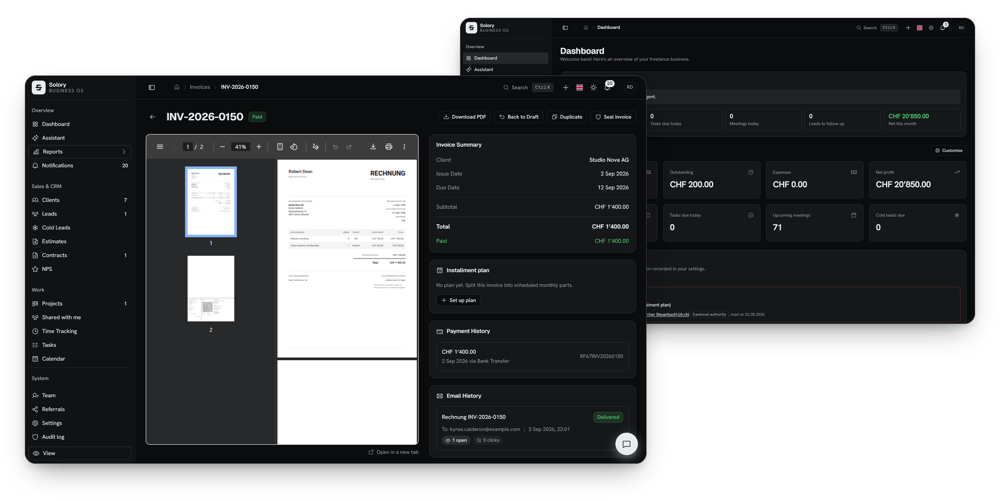
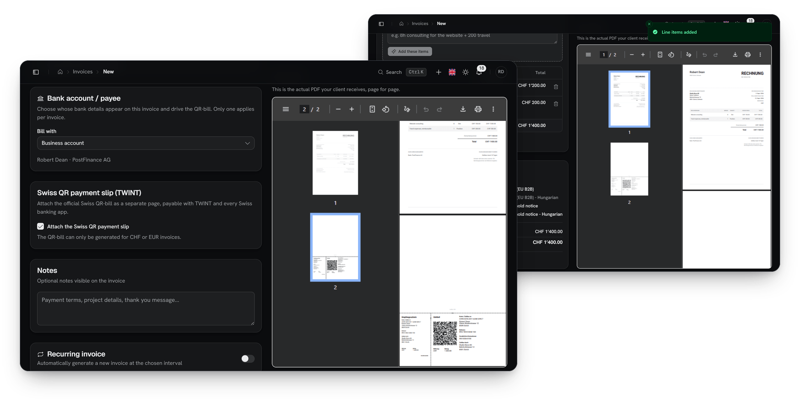
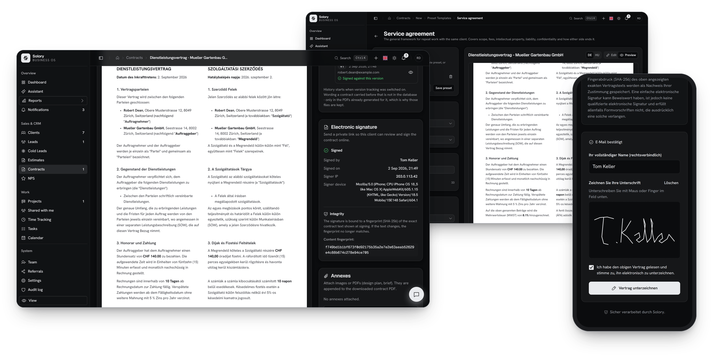
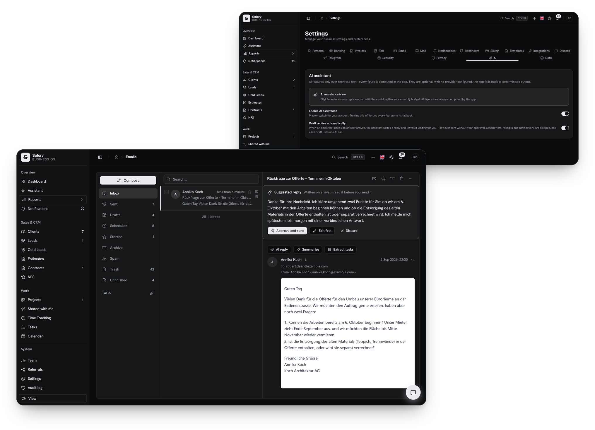
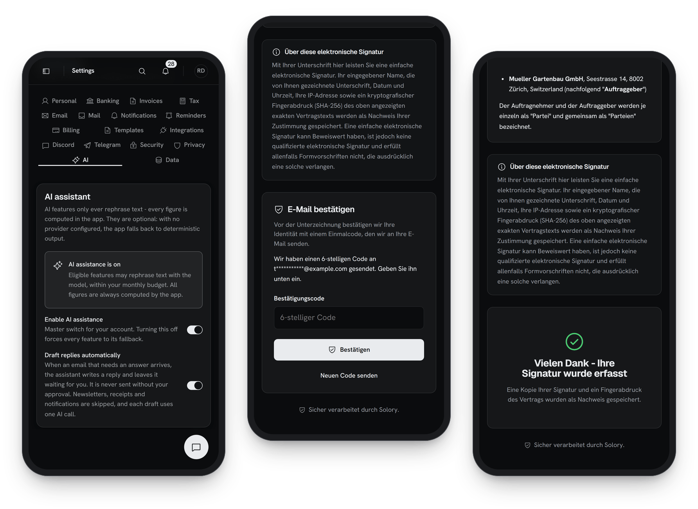
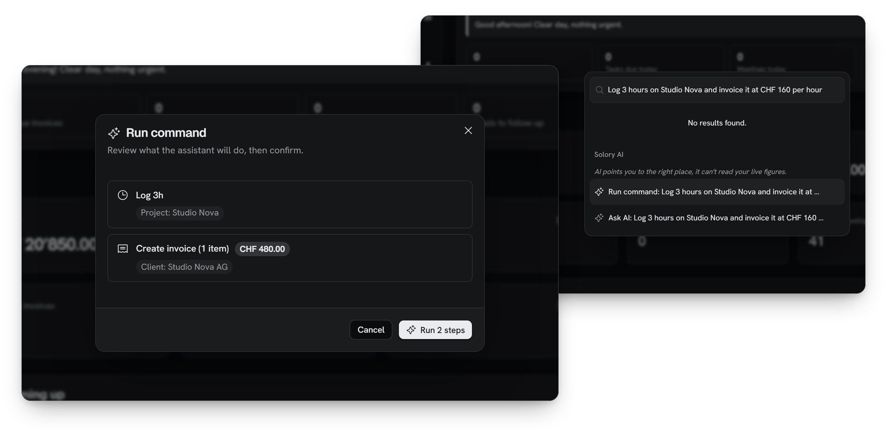

<h1 align="center">Solory</h1>

  <strong>The operating system for Swiss sole traders.</strong> 
  Swiss QR-bill invoicing, clients, time, expenses, contracts, bank reconciliation and business email in one app, with an AI assistant that changes nothing until you confirm.

  <strong>Launching soon</strong> · built and running in production · waitlist open at <a href="https://www.solory.ch">solory.ch</a>

  <a href="#at-a-glance">At&nbsp;a&nbsp;glance</a> · <a href="#features">Features</a> · <a href="#the-ai-assistant">AI&nbsp;assistant</a> · <a href="#keeping-up-with-swiss-rules">Swiss&nbsp;rules</a> · <a href="#security-and-privacy">Security</a> · <a href="#reliability">Reliability</a> · <a href="#how-its-built">How&nbsp;it's&nbsp;built</a> · <a href="#status">Status</a> · <a href="#about">About</a>

   
  Product UI with demo data

## At a glance

- **Made for the Swiss one-person business (Einzelfirma).** Invoicing, clients and leads, projects and time, expenses, contracts, bank reconciliation, business email, calendar and deadlines live in one workspace.
- **The official Swiss QR-bill on every eligible invoice**, with the right structured reference picked automatically and every missing prerequisite named before you send.
- **An AI assistant with a closed list of 20 actions.** It turns a sentence into a plan, shows which records each step touches and what the amounts are, and runs nothing until you confirm. It cannot delete anything and never sends email on its own.
- **Watches official Swiss sources.** A background job keeps re-reading the official pages behind every recorded figure; a person checks every change against the authority's page before a figure is updated. Every figure shows its source and the date it was read.
- **Reminders in the app, by email, on Telegram or on Discord**, plus a two-way Google Calendar connection with optional Google Meet links (open to all accounts once Google has finished verifying the app).
- **Business email on your own domain**, with AI reply drafts that wait for your approval.
- **Five languages end to end.** The app, the PDFs and the emails are available in English, German, French, Italian and Hungarian, and each document goes out in its own language, by default the client's.
- **Records stored in Switzerland.** Database and files are hosted in Zurich, every account is isolated by the application and again by the database, and optional two-factor authentication protects the data itself, not just the login screen. AI and email providers process limited data outside Switzerland, as listed in the privacy policy.
- **Built and run by one developer**, backed by about 17,000 automated test cases.

## Features

### Swiss invoicing and the QR-bill

Every invoice starts as a draft with line items, units and payment terms, and the preview next to the form is the real PDF, rendered from what you have typed so far. When it is ready you can send it by email with the PDF attached (after seeing the exact email your client will get) or simply mark it as sent. Numbering, templates, branding and the document language are handled for you.

Every eligible invoice gets the official Swiss QR-bill, the 210 x 105 mm payment part with receipt, as its own last page, payable with any Swiss banking app. With a QR-IBAN, Solory prints a QR reference derived from the invoice number; with an ordinary IBAN it uses an ISO 11649 creditor reference. If anything is missing (IBAN, address, creditor name, currency, amount range), the app lists every missing item at once and still produces the PDF, without the payment part.

  

<strong>More on invoicing, payments and reminders</strong>

**Invoices**
- Automatic numbering per account (for example `INV-2026-0001`), protected against a counter that would re-issue an old number.
- Three PDF templates (classic, modern, minimal) with your logo and accent color.
- 14 text placeholders with offsets, so `{{month}}` and `{{month+1}}` print this month and next month by name.
- Default payment terms of 30 days, overridable per invoice. Duplicate, bulk status changes, revert to draft (refused once payments exist) and cancel (refused once money has arrived).
- Turn unbilled time entries into invoice lines in a few clicks.
- Any invoice currency; the QR-bill is available for CHF and EUR.

**QR-bill details**
- IBANs are checked for shape and checksum; only Swiss and Liechtenstein accounts are accepted.
- Several bank accounts per business, including third-party payee accounts. Each invoice picks one.
- The invoice number is also placed in the payment message.
- The payment part is printed in German, French, Italian or English. Accented names print correctly.
- Credit notes never carry a payment slip.
- Before an email goes out, Solory checks that the attached PDF is current, so a client never receives an outdated QR-bill.

**Payments**
- Record payments with amount, date, method and reference. The invoice status is derived from the payments, computed in whole cents, so an invoice can never disagree with its receipts.
- Partial payments, and a daily sweep that marks invoices overdue (and back to sent once they are no longer in default).
- Installment plans with 2 to 24 monthly parts that must add up to the total exactly, with an alert when a part lapses (Business plan).

**Recurring invoices**
- Weekly, monthly, quarterly or yearly. Exactly one draft per period, missed periods are caught up, and the same period can never be billed twice.
- Optionally emailed automatically with the PDF.

**Reminders and Swiss dunning (Mahnung)**
- Client-facing payment reminders with three modes per reminder type: off (the default), approval (prepared and waiting for you to release it) or automatic on your schedule.
- Editable reminder texts per language with a locked, consistent layout.
- A Mahnung card shows where an overdue invoice sits on the Swiss reminder ladder, with suggested fees and default interest at 5% a year (Art. 104 OR), for display only. Solory never starts debt collection (Betreibung).
- Client-facing reminders are on the Professional and Business plans.

**Corrections, sealing and closed periods**
- Corrections go through credit notes (Gutschrift) that reference the original invoice.
- An issued invoice can be permanently sealed: a fingerprint of its content and of the archived PDF is stored, the database refuses any later change except the payment status, and the seal can be re-verified at any time.
- Whole periods can be closed, for a financial year or a custom range. Nothing dated inside a closed period can be created, edited, deleted or paid against until you reopen it.

### VAT (MWST)

Solory applies the Swiss VAT rate that was valid on the date of supply, prints the right notices and watches your turnover against the registration threshold. It computes the figures; it does not file returns.

- Date-based rates: 8.1%, 2.6% and 3.8% from 2024, and 7.7%, 2.5% and 3.7% for 2018 to 2023.
- Reverse-charge note for EU business clients, and the notice for businesses not registered for VAT.
- Warnings when the VAT setup contradicts itself (a VAT number stored but the "not registered" notice switched on, or registered without a number).
- Threshold monitor: a rolling 12 months against CHF 100,000, with a warning from 80%. Only sent, paid and overdue invoices count.
- Accounting method (effective method, net tax rate method, also called Saldosteuersatz, or annual reporting) and filing cadence, with the next VAT due date shown.

### Clients, leads and estimates

**Clients.** A client record holds everything that ends up on your documents: address, four separate tax identifiers (VAT, EU VAT, UID, MWST), a default hourly rate and the client's document language. Import existing clients from CSV with column mapping and a preview that marks new rows, duplicates and rows without a name (up to 2,000 rows). The client list shows projects, revenue and outstanding amounts at a glance.

**Leads.** Prospects move through a pipeline of 13 fixed statuses with notes, a timeline and a transparent rule-based score from 0 to 100 (Hot, Warm, Cold) with a per-rule breakdown. Solory reminds you when a lead has waited too long for a reply, and converting a lead into a client keeps its notes and history. Messages from your own website's contact form can arrive in Solory and become leads automatically (set up on request).

**Cold leads and outreach.** Imported prospect lists live apart from real leads: an Excel template with 46 columns, a header-matched import of up to 10,000 rows with preview, up to 30 custom fields, and export to CSV, Excel, JSON or plain text. Follow-up sequences send the steps you wrote, with a one-click opt-out for the recipient. Optional email verification checks whether addresses are deliverable.

**Estimates.** Quotes can mix one-off and recurring lines (monthly, quarterly, yearly) with a subtotal per frequency. Your client opens a link, sees the real PDF and accepts or declines online, and you get notified. An accepted quote becomes an invoice or the start of a contract.

**Newsletter, NPS and referrals.** Send newsletters to your own subscribers (schedule, pause and resume, with one-click unsubscribe), ask clients for a Net Promoter Score through a private link, and share a personal referral code.

### Projects, time and tasks

Projects belong to a client and are billed hourly or at a fixed price, with an optional budget in hours or money. The project page shows total, billable and unbilled hours, revenue, effective hourly rate and how much of the budget is used.

Time is tracked with a timer (start, pause, resume, stop, rounded to the nearest quarter hour) or entered afterwards. Every entry belongs to a project and is billable or not; list and calendar views show daily totals and the value of unbilled hours. Selected unbilled entries become invoice lines at the project rate, and hours on an invoice are locked so nothing is billed twice. Canceling the invoice puts them back in the queue.

Subcontractors can be invited by email to a single project, where they log their own hours without seeing your rates, invoices or other projects. The restriction is enforced in the database, not just hidden in the interface, and revoking access is immediate.

Tasks carry a due date, one of four priorities, file and link attachments, and an optional link to a client or lead.

### Expenses and receipt scanning

Book business costs in 14 categories with the receipt attached (PDF, JPG or PNG up to 10 MB). On the phone you can photograph a receipt even without signal: the photo waits in an offline queue and uploads when the connection is back.

**Scan receipt** reads a photographed receipt and prefills vendor, date and amount; uploading a receipt never starts a scan on its own. It checks that the VAT lines on the receipt add up to the total within 5 Rappen and asks you to review when they do not. If the receipt is in a foreign currency, the amount is left empty and you are asked for the CHF figure, because Solory deliberately never guesses an exchange rate. A category suggestion is based on your own most similar past expenses and falls back to keyword rules when AI is off. Nothing is saved until you press save.

Recurring costs (weekly, monthly, quarterly, yearly) are booked as real entries exactly once per period, with catch-up after a gap and never into a closed period. Linking an expense to a project feeds that project's profitability.

<strong>Also included: fixed assets, mileage and inventory</strong>

- Fixed-asset register with straight-line or declining-balance depreciation at a rate you set.
- Business mileage log valued at a configurable rate per kilometer (CHF 0.70 by default), with a reminder to confirm the rate with your tax office.
- Inventory items with stock adjustments and a movement history (Business plan).

### Contracts and e-signature

Draft contracts from nine Swiss-oriented templates, add priced positions and annexes, then send a private signing link. Your client confirms their email address with a code, signs by drawing, you countersign, and the exact signed PDF is archived. Contracts are on the Professional and Business plans.

  

- **Nine templates:** Service Agreement, Statement of Work (with a dedicated variant for digital builds), Werkvertrag (contract for work), Mandate, Recurring services, B2C terms, Brokerage, NDA and License.
- **Written per language.** Each of the five languages has its own clause text, so nothing is translated when the PDF is rendered, and German uses Swiss spelling (ss, never ß). A contract can also be rendered as a bilingual two-column PDF that names the prevailing language.
- **Rich-text editor**, priced positions rendered as a table inside the contract, image and PDF annexes appended to the contract PDF, and a read-only version history. A contract can start from an accepted estimate.
- **Signing link** valid for 7, 14 or 30 days or without expiry. Signing links are kept out of search engines.
- **Signer verification:** a 6-digit code sent by email, valid for 10 minutes, with limited attempts. The signer types their legal name, draws a signature and gives explicit consent; the time, IP address, browser and a fingerprint of the exact content are recorded.
- **Countersigning:** in the signing flow, the contract becomes Signed only when both sides have signed; a contract signed on paper can be marked as signed by hand. The e-signed PDF is archived byte for byte, never re-rendered, and protected against replacement.
- Solory provides a simple electronic signature, not a qualified electronic signature (QES).

**Client portal.** Each client can get a private, read-only link to view and download their sent invoices, sent estimates and linked documents in their own language, with no login. The link is valid for 7, 30 or 90 days or without expiry, generating a new one revokes the old one, and drafts are never shown. Individual files can be shared through links that expire after at most 30 days, with an optional download limit.

### Bank reconciliation (camt.053 and camt.054)

Export a camt.053 statement or a camt.054 notification from your e-banking and upload it. Solory shows a preview first: each entry is marked as an automatic match, a suggestion, no match or already imported. Only a payment carrying the exact QR or creditor reference of an open invoice is matched automatically; a match on amount alone is a suggestion you confirm. You never share a bank login. Bank import is on the Business plan.

- Built for any bank that exports ISO 20022 camt files, in both batched and single-entry layouts (files up to 20 MB).
- Safe to repeat: re-importing a file, or seeing the same payment in the daily camt.054 and the monthly camt.053, never creates a duplicate, and a batched QR collection is split into one row per payer.
- Unmatched, Matched, Ignored and All tabs, search by debtor or reference, and match, ignore, undo and restore.
- Confirming a match records a normal payment, so closed periods and invoice status rules still apply. A transaction you handled by hand is never re-matched by a later upload.
- For a payment that has no exact match, **Suggest with AI** proposes the most likely open invoice with a confidence level and a short reason, or says there is no confident match. The model may only choose from a shortlist of your open invoices that is built in code, and you still confirm the match yourself.

### Email on your own domain

Connect a domain you own and Solory becomes its mailbox. You send and receive from your own addresses, signed with your domain's DKIM key, right next to your clients and invoices. Solory is the mailbox itself; it does not sync Gmail or Outlook.

  

- **Guided setup:** Solory prints the exact SPF, DKIM, MX, tracking and DMARC records with copy buttons and plain-language explanations, checks them automatically until the domain is verified, and keeps checking daily so you are warned if the MX records disappear later.
- **Unlimited addresses** per domain, each able to send and receive, with a catch-all and a default sender. Free mailbox domains such as gmail.com cannot be connected.
- **Inbox, Sent, Drafts, Starred, Archive, Trash, Spam and Scheduled** folders plus custom tags and an all-mailboxes view. Rich composer with inline images and quoted history; attachments up to 15 MB per file and 18 MB per message.
- **Scheduled sending** from 2 minutes to 365 days ahead, with independent safeguards so a message never goes out twice.
- **Per-recipient delivery timeline** (delivered, opened, clicked, bounced, marked as spam, unsubscribed). Opens by automated link scanners are labeled as such. Bounce, complaint and unsubscribe lists are kept in sync automatically.
- **Templates and signatures:** editable client-facing templates (invoice email, overdue reminder, installment reminder, NPS request) in five languages, and an email-safe signature designer.
- **AI help in every thread:** draft a reply, summarize the thread with a next step, or pull out action items as tasks. Optional automatic drafts for incoming mail wait for your approval. See [Email drafting](#email-drafting).

### Google Calendar, two-way, with Google Meet

The Google connection is built and in use. Until Google finishes verifying the app, it is limited to test accounts and has to be reconnected weekly.

Connect a Google account under Settings and your Google Calendar meetings appear next to your own schedule, with reminders before they start. Meetings you create in Solory, from the calendar, from the lead pipeline or through the assistant, appear in your Google Calendar right away, optionally with a Google Meet link.

- **Google to Solory:** every 5 minutes Solory reads the next 7 days of your primary calendar. Events canceled in Google are marked canceled in Solory, so no reminders go out for them.
- **Solory to Google:** entries are written to Google as soon as they are saved. If Google is briefly unavailable, a background check delivers them later, without duplicates.
- **Google Meet:** add a Meet room to a meeting and remove it later. If your Workspace policy refuses Meet, the meeting is still created.
- **Deletes only its own events:** Solory removes a Google event only if it created that event itself. Meetings you created in Google are never touched.
- **No double reminders:** events Solory pushed to Google are not read back as new meetings.
- **Reminders** 60 and 10 minutes before a meeting, in the app and, if you set them up, by email, Telegram or Discord.
- **Client invitations** are optional per meeting and are sent by Solory from your business email address with a calendar file attached, never by Google. Updates and cancellations change the existing entry in the client's calendar instead of adding a second one.
- **Narrow permissions:** your basic Google identity (to show which account is connected) and permission to see and edit calendar events. Solory does not ask for full calendar control, so it cannot delete calendars or change their sharing. If you untick the calendar permission on Google's consent screen, Solory adapts to what you actually granted.
- **Graceful disconnects:** if Google revokes access, Solory stops calling Google and tells you once in the app and once by email, with one reminder a week later. Reconnect resumes syncing; you can disconnect at any time.

Google support covers Google Calendar and Meet; there is no Google sign-in, Gmail, Drive or Contacts integration.

The Solory calendar itself also shows invoice due dates, contract expiry dates and your VAT and statutory deadlines, plus a list of meetings in the next 14 days.

### Notifications: in the app, Telegram and Discord

An in-app notification bell covers 16 kinds of events, each of which you can switch on or off: payments received, overdue invoices and installments, accepted or declined estimates, signed contracts, completed projects, tasks due, meeting reminders, new email, new website inquiries, compliance deadlines and a disconnected integration, among others.

- **Telegram:** link your account with a one-time code and receive events in a private chat, with quiet hours. The same chat is also a full assistant (see [Telegram](#on-telegram)).
- **Discord:** events posted to a channel of your choice, with message templates you can edit.
- **Email to you** for key events such as lead follow-ups, installment alerts, new inquiries and deadline notices.

Telegram and Discord are optional. They are not covered by a data processing agreement, so Solory advises against forwarding client data to them.

### Swiss deadlines and tools

Solory works out your own Swiss filing and payment deadlines, such as VAT returns, AHV payments and cantonal tax installments, from your canton and your business settings, and reminds you 14 days before, 3 days before and on the day (Professional plan and up). Cantonal dates are added canton by canton, each only after a person has checked it against the canton's own page. How these deadlines are sourced and kept current is described in [Keeping up with Swiss rules](#keeping-up-with-swiss-rules).

Built-in calculators cover VAT, AHV/IV/EO, BVG, FABI and the net tax rate method compared with the effective method. Each one states the year of its data and recommends confirming with a fiduciary (Treuhänder). A pillar 3a (Säule 3a) card computes your deductible maximum from the profit you have actually booked this year, and a reference guide explains Swiss business insurance.

### Reports, import and export

Year-end figures come straight from your own invoices, payments and expenses. Revenue counts on the day the money actually arrived, VAT is split across part payments to the cent, and VAT is never counted as revenue.

- **Annual tax report:** revenue by client and by quarter, a VAT summary and expenses by category, exportable as CSV or JSON with headings in five languages.
- **Income statement (Erfolgsrechnung)** with a prior-year column, switchable between accrual and cash basis.
- **Project profitability:** revenue, expenses, labor, profit, margin, hours, budget used and effective hourly rate.
- **Cashflow projection** over several weeks with best, likely and worst bands, an AHV reserve and a VAT set-aside, based on how quickly your clients actually pay, with what-if scenarios.
- **Client concentration warning** when one client brings in more than half of your revenue, and **revenue by canton**.
- **Records archive** for the 10-year Swiss retention duty (Art. 958f OR and GeBüV), with keep-until dates.
- **Import:** clients from CSV (uploaded or pasted) and cold-lead lists from Excel, each with a preview before anything is created.
- **Export:** download your core records (clients, projects, time, invoices, payments, expenses, contracts, email log) as JSON or CSV at any time. If a section could not be read, the file says so instead of looking empty, and CSV files are protected against spreadsheet formula injection. A tax export refuses to add EUR to CHF at 1:1 when your books mix currencies.

### Dashboard

The first screen after sign-in is yours to arrange: up to 40 tiles from 18 types (revenue, expenses, profit, outstanding and overdue amounts, estimated tax, active projects, hours this month, tasks today, upcoming meetings, open leads and estimates, signed contracts, unread email, NPS score, your own notes and more) on a 12-column grid, each one resizable. Revenue charts, unpaid invoices, upcoming obligations and a recent-activity feed sit alongside, and a daily brief summarizes the day from your own figures.

### Team, accountant and subcontractors

- Invite team members by email or by a shareable link valid for 30 days, and switch between your own and shared accounts. Members see and manage the whole account; personal profiles and signatures stay private.
- Give your fiduciary (Treuhänder) read-only access to invoices, expenses and the financial summary, bound to their email address and revocable at any time (Professional and Business plans).
- Add subcontractors to individual projects (see [Projects, time and tasks](#projects-time-and-tasks)).

### Onboarding and the Swiss trade catalog

A guided first-run wizard sets up your business step by step: identity, address, trade, services, VAT status, invoicing, payment details for the QR-bill, branding, language, notifications and your first client. It can be resumed at any time. Picking your trade from a catalog of 161 Swiss one-person trades in 18 groups tailors your service list and shortlists the matching contract templates. Typical market price ranges are shown as editable observations, not as recommendations.

### On the phone

Solory installs to the home screen as a web app and has an offline fallback page. A receipt photographed on the go is kept in an offline queue until the connection is back and can then be scanned into a prefilled expense. Everything else needs a connection. Settings and the client's signing page work on any phone.

  

### Five languages

The app, the PDFs and the emails are available in English, German, French, Italian and Hungarian. Each document carries its own language: you can work in German and send a French invoice, and the email and attached PDF always match. The language is taken from the invoice, then the client, then your account, and the form shows which one applied. Register names such as IBAN, UID and MWST are never translated.

## The AI assistant

The assistant is optional and does real work in the app, but it never changes anything without you. It turns a plain-language request into a plan of typed steps, shows you exactly which records each step will touch and what the money amounts will be, and runs only after you confirm.

  

### Where it lives

One assistant, four ways in, all with the same approval step:

- **Command bar (Cmd/Ctrl+K):** "Run command" builds a plan you can confirm; "Ask AI" answers, lists, briefs or takes you to the right page.
- **Chat panel** in the corner of every app page. It follows the conversation, so follow-ups like "list them" or "yes, do it" work.
- **A private Telegram chat**, with voice notes, receipt photos and confirmation buttons.
- **The Assistant page**, where you teach it about your business: knowledge base, writing samples, tone and preferred terms.

It answers in your app language (English, German, French, Italian or Hungarian).

### What it can change: a closed list of 20 actions

The assistant can propose exactly 20 kinds of change and nothing else. Anything else the model produces is dropped before you ever see it. There is no delete action and no send-email action.

<strong>All 20 actions, grouped</strong>

**Clients (2)**
- Create a client.
- Update a client's name, email or phone.

**Projects and time (4)**
- Create a project (hourly or fixed price).
- Rename a project.
- Set a project's status (active, completed, on hold, archived).
- Log time (up to 24 hours, billable or not, on a given date).

**Tasks (2)**
- Create a task with a due date, priority, up to 10 links and an optional client or lead.
- Complete a task.

**Leads (3)**
- Add a note to a lead.
- Move a lead to another pipeline status, optionally with a quoted amount.
- Update a lead's name, email or phone.

**Money (5)**
- Create an invoice with up to 30 line items, currency, VAT rate and due date. When VAT is not stated, it is worked out from your account and the client exactly as the invoice form does.
- Create an estimate the same way.
- Set an invoice to sent, paid or canceled. "Sent" only changes the status and never emails anything; canceling goes through the real cancel flow, which releases the billed hours.
- Record a payment, for an explicit amount or the full remaining balance.
- Book an expense in CHF. Foreign amounts are refused rather than converted.

**Contracts (2)**
- Create a draft contract, only from text you supplied.
- Set a contract's status.

**Calendar and stock (2)**
- Schedule a calendar event.
- Add an inventory item.

One plan can chain steps that depend on each other, for example "create the client Acme, then a project for Acme, then log 3 hours on it".

### What it can read and explain

Without changing anything, the assistant can:

- **List and search 9 record types:** invoices, leads, clients, projects, tasks, estimates, expenses, payments and contracts, with plain filters such as unpaid, overdue or stale leads.
- **Give 8 kinds of briefing:** today, finances, upcoming deadlines, the lead pipeline, or one named lead, client, project or contract. The figures are computed in code from your data; the model only phrases them and is instructed to keep every number exactly. If AI is unavailable, you get the plain figures.
- **Take you to 24 places** in the app, including 7 "start new" forms. It opens the form for you and never submits it. It cannot invent an arbitrary link.
- **Answer short how-to questions.**

### Approval first, step by step

1. **You ask.** Type what you want (or send a voice note on Telegram), for example "Add the client Acme, open a project Website for them and log 3 hours of design today".
2. **It plans, read-only.** Your request becomes a typed plan built only from the 20 actions. Planning changes nothing.
3. **You review.** A dialog lists every step in plain language with the real records it will touch (client, project, lead, task, invoice or contract) and the amount for every money step, VAT included and computed the same way the actual write will compute it. A name that is ambiguous or not found blocks that step with a warning.
4. **You confirm.** The button names the number of steps that will run (for example "Run 2 steps") and is disabled when none can. On Telegram, money steps ask a second time with the exact amounts.
5. **The server checks again.** It never trusts the plan sent back from the browser: it validates every step again and re-resolves every name against your own account before writing. Invoices, payments and expenses go through the same validated actions as the normal forms, so closed periods, plan limits and VAT rules still apply.
6. **You see the result.** Each step reports done, skipped or failed, and the executed plan cannot be run a second time.

### Guardrails

- No auto-approve mode, no delete action, and no way for the assistant to send an email.
- At most 12 steps per plan and 30 line items per invoice or estimate; time entries between 0 and 24 hours; real calendar dates and valid email addresses only; statuses only from fixed lists.
- Conservative name matching: an exact match first, then a stored name that contains what you typed. If several records match, the step is blocked instead of guessed.
- The planner sees only the names of up to 60 of your clients, projects and leads, never their email addresses or amounts.
- Plan-limited features stay limited: a contract or inventory step fails with the normal plan message if your plan does not include it.
- Payments booked by the assistant are labeled "Recorded via assistant".
- Double-click protection, and per-user rate limits.

### On Telegram

Link your Telegram account with a one-time code (single use, valid for 15 minutes) and use the same assistant in a private chat:

- Slash commands such as `/today`, `/finances`, `/deadlines`, `/leads`, `/invoices`, `/clients`, `/projects`, `/tasks` and `/contracts`.
- **Voice notes** up to 5 minutes are transcribed, the transcript is shown back to you, and only then handled like typed text.
- **Receipts and files:** a receipt photo becomes a prefilled expense to confirm, and for a PDF or image the bot first asks whether to save it as a document or book it as an expense.
- **Questions** are answered from your own knowledge base.
- **An optional morning briefing** at the hour you choose.
- Proposed changes arrive with Accept and Reject buttons, expire after 10 minutes and run at most once. Money steps ask for a second confirmation (on by default). You can make the bot read-only, block all money actions, or set quiet hours. The bot works only in private chats.

### Email drafting

Inside Solory's own inbox, every thread has three AI buttons:

- **Draft a reply.** It reads the latest messages in the thread, answers in the thread's language, and uses your tone and preferred terms. Your price list is consulted only when the latest message asks about price. You edit the draft before using it. Your signature is added by the app, not written by the AI.
- **Summarize** the thread as bullet points with a suggested next step.
- **Extract action items**, labeled as yours or as waiting on the other side, and turn any of them into a task or a follow-up with one click.

**Automatic drafts** are opt-in and off by default. When switched on, a quick header check skips newsletters, receipts, no-reply senders and auto-responders, and only senders that pass email authentication checks are considered. The assistant decides whether a reply is needed and writes the draft, which then waits for you: approve and send, edit, or dismiss. Nothing is sent without your approval.

The composer also has an **AI draft** button for a short follow-up or general message.

<strong>More AI features</strong>

**More AI helpers**
- **Invoice lines from a sentence:** describe the work and get up to 20 line items to add to the form. Missing prices fall back to the client's hourly rate for time items; VAT and totals are computed by the form, and you still save the invoice yourself.
- **Line descriptions from unbilled time:** hours are summed in code, the AI only polishes the wording, with a template fallback.
- **Forgotten time?** suggests entries for projects you usually log but have not logged that day, from your own history.
- **Lead next step:** a suggested next action with priority, reason and a follow-up draft to copy.
- **AI lead score:** a history-aware score from 0 to 100 with a one-line reason, shown next to the rule-based score, which stays as the fallback.
- **Meeting notes:** paste your call notes and get a summary, key points, action items (as tasks) and a suggested follow-up date for the lead's timeline.
- **Estimate win probability** and pricing hints, based on your own past won and lost quotes.
- **Cold outreach writer:** choose language, formality and length; it uses your services and writing samples, mentions a price only if you typed one in, and is never sent automatically.
- **Plain-language money summary** on the Reports page: the figures are computed in code and the AI only phrases them.

**Translations**
- **Contracts:** the scope-of-work fields (description, deliverables, milestones) can be translated into the contract's second language with a terminology glossary, for bilingual contracts.
- **Swiss reference notes:** explanatory notes on settings screens can be translated into your language on request, with a guard on figures. Official facts themselves stay in the language the authority published them in.
- The app interface uses fixed, stored translations in all five languages; AI translation is used only in the two places above.

**Knowledge base and brand voice**

On the Assistant page you store what the AI may use about your business: prices and price lists, services, service areas, categories, FAQs and notes, plus your tone, preferred terms, outreach style and sample emails. Only the entries relevant to the current request are used. Reply drafts consult your price list only when a client asks about cost, and cold outreach never includes your internal prices.

### Limits, in plain terms

- AI is optional. A master switch in Settings turns it off for you.
- Every plan includes a monthly allowance of AI actions for each person on the account: 25 on Free, 300 on Starter, 1,000 on Professional and 3,000 on Business. Each model call, receipt scan or voice transcription counts as one action. The Settings page shows what you have used and what is left, and for team accounts the usage per member.
- When AI is off or the allowance is used up, the rest of Solory keeps working. Briefings, the Reports money summary, line descriptions, the composer draft, time suggestions, category suggestions and lead scores fall back to template or rule-based output, and a receipt scan leaves the form empty for you to fill; the other AI buttons tell you AI is unavailable.
- There is no undo button. Steps run in order, and a failed step does not roll back the ones before it. Corrections are made in the normal screens, for example by canceling an invoice or deleting a payment.
- The review shows each step's summary, the records it touches and the totals, not a field-by-field diff.
- The assistant runs on OpenAI's API (language, vision, speech-to-text and embedding models). OpenAI is listed as a subprocessor in Solory's privacy policy, and data sent through the API is not used for training.

## Keeping up with Swiss rules

Swiss rules for small businesses change: VAT rates, AHV contributions, deadlines, thresholds. Solory keeps a curated reference of what Swiss authorities publish, re-reads the official pages behind it on a schedule, and flags every change for a person to review. **Changes are detected automatically; updates are approved by a human.** Solory never rewrites a figure on its own.

- **What is covered:** about 125 recorded rules and figures across 37 topics, 34 filing and payment obligations and 8 permit entries, each citing an official source page.
- **Which sources count:** a figure may cite only a site on a whitelist of 90: 54 federal, 32 cantonal covering all 26 cantons and 1 communal authority, plus 3 private standards bodies. A private specification such as the QR-bill implementation guidelines is labeled "not law" on screen. A site does not count as official just because its address ends in .ch.
- **Where it looks:** the watcher re-reads the pages that the recorded figures actually cite, not every site on the whitelist.
- **How often:** each cited page is re-checked about every 14 days, a broken link about weekly.
- **What it detects:** changed text, changed numbers, dead or moved links and blocked access. It also checks whether the exact recorded figure still appears on the page.
- **Polite by design:** it respects robots.txt, limits itself to a few pages per site per run with pauses between requests, uses conditional requests so an unchanged page costs the authority almost nothing, backs off when a site is busy, and identifies itself.
- **The machine only observes.** It cannot change, hide or delete a figure, and the database enforces that, not just the code. A reviewer either re-confirms the figure ("the source still says this") or adds a new dated version taken from the official page and publishes it.
- **Nothing stale is shown as current.** Every entry has a review date. When it passes, the entry is marked for review; once the grace period also passes, the figure is no longer shown or used in calculations until it has been checked again.
- **What you see:** a "read on" date with the authority and a link on every entry, and a clear note that this is information, not legal or tax advice. Official facts are shown in the language the authority published them in and are never machine-translated.
- **What changed** (Business plan): a page for your canton listing figures that came into force, figures with an announced end date, sources that changed and reviews that lapsed.
- **Compliance dossier** (Business plan): one dated PDF of everything that applies to you, with the authority, the full page address and the date read for each entry, ready for your fiduciary or an audit file.

<strong>Topics in the reference</strong>

- **VAT (MWST):** standard, reduced and accommodation rates; the registration threshold; filing and payment deadlines; net tax rate ceilings; rounding; invoicing in foreign currency; record retention.
- **AHV/IV/EO for the self-employed:** contribution scale, minimum contribution, payment periods and ceilings, and family allowance contributions.
- **Direct federal tax:** deadlines, interest and the top marginal rate.
- **Withholding tax (Verrechnungssteuer):** rates and deadlines.
- **Bookkeeping (OR):** bookkeeping duties and record retention.
- **Company law:** commercial register thresholds and GmbH capital.
- **Pillar 3a:** deduction maximums.
- **Swiss QR-bill** facts and **e-invoicing** for federal contracts.
- **Permits:** electrical installation, food businesses and gastronomy in Zurich.
- **Cantonal taxes:** deadlines and interest for Zurich, Bern and Lucerne.

### Your own deadlines

From this reference, a daily job works out your personal deadlines, filtered to your canton and to the answers in your settings (for example whether you are VAT-registered).

- Notices arrive 14 days before, 3 days before and on the day: in the app by default, by email if you switch it on.
- You never get a cantonal deadline for a canton you are not in, a deadline based on a setting you have not answered, or the same notice twice.
- Every notice names the authority and the date its page was read. Dates are shown exactly as published and are not moved for weekends or public holidays, and the notice says so.
- Deadlines triggered by an event rather than a calendar date are listed separately and never given an invented date.
- Deadlines also appear on the calendar and in the dashboard's upcoming obligations.

## Security and privacy

- **Your records are stored in Switzerland.** The database and private file storage are hosted in the Zurich region; the application runs in Frankfurt. AI requests go to OpenAI and email is delivered by Mailgun, so limited data is processed by those providers, as listed in the privacy policy.
- **Every account is a closed box,** enforced twice: by the application on every read and write, and again by the database itself.
- **Optional two-factor authentication** with an authenticator app and 10 single-use recovery codes. A session that has not completed the second factor cannot reach your records or files (receipts, signed contracts, documents, mail attachments), not just the screens.
- **A tamper-evident audit log** you can filter, verify and export as CSV. It records creates, edits and deletes, exports, sign-ins, seals, signatures and security changes.
- **Links stored as fingerprints.** Portal, signing, estimate and survey links are stored only as a one-way fingerprint. Portal and signing links last for the period you choose and survey links for 30 days, and generating a new portal or signing link revokes the old one. Private files are served only through short-lived signed links.
- **Encrypted connections** (HTTPS) and hardened browser security headers. Stored third-party connection credentials, such as the Google Calendar connection, are encrypted inside the application.
- **Export and deletion.** Export everything as a ZIP (structured JSON plus a README) at any time. Account deletion is self-service with a 30-day grace period you can cancel; afterwards sign-in is disabled, files and connected channels are deleted, and the remaining data is anonymized. Accounting records that Swiss law requires to be kept for 10 years are retained with personal details removed.

## Reliability

- Solory checks its own components around the clock. Incidents open automatically when a check keeps failing and close when the component recovers.
- A [public status page](https://www.solory.ch/status) shows 90-day uptime bars per component, computed from incidents that were actually recorded, an incident timeline and scheduled maintenance.
- A watchdog keeps confirming that each scheduled job actually completed, so a job that fails silently is caught.
- When the hosting provider reports a problem that affects Solory, the app shows a notice.
- Product updates are published in a [public changelog](https://www.solory.ch/changelog).

## How it's built

**Stack:** Next.js · React · TypeScript · Supabase (PostgreSQL) · CSS Modules · OpenAI API · Mailgun · Stripe · Vitest · GitHub Actions · Vercel

- **Approval is enforced on the server, not in the UI.** The model's reply is parsed into a fixed set of 20 typed actions with validated parameters; anything else is dropped. After the user confirms, the server validates and resolves the whole plan again against the account's own records instead of trusting what the browser sends back. An adversarial test suite feeds hostile model output to every validator.
- **Numbers come from code, words from the model.** Briefings, the money summary and invoice line descriptions are computed in code and only phrased by the model, under an instruction to keep every figure exactly, with a plain template as the fallback. The amount on the confirmation screen is computed by the same code that writes it.
- **QR-bills built to the standard.** The payment part is rendered as a separate PDF page and appended to the invoice. The reference type follows the IBAN type, the slip follows the invoice's language wherever the standard allows it, and eligibility is checked up front with every missing prerequisite named.
- **Bank import that is safe to repeat.** A bank-agnostic ISO 20022 parser gives every individual payment a stable key, so re-imports never duplicate a payment and batched collections never collapse into one row. Only an exact structured reference is matched automatically.
- **Exactly once, even after downtime.** Recurring invoices and expenses are created once per period, guaranteed by the database, with catch-up after a missed run. Scheduled email has independent safeguards against double sending. About 30 scheduled background jobs run under a watchdog.
- **Money in whole cents.** Payment status, totals and VAT are computed in integer cents. Revenue is recognized on the payment value date, with VAT split across part payments to the cent.
- **Records that cannot be quietly changed.** Sealed invoices, closed periods and the hash-chained audit log are enforced by the database, not just hidden in the interface. Signed contracts are archived byte for byte.
- **Every account is a closed box.** The server resolves the active account and verifies membership before any read or write, and Postgres row-level security enforces the same boundary underneath. Two-factor authentication is enforced at the data and file layer.
- **Five languages, held by tests.** The build fails when a key used in the code is missing in any language. Contract clauses are written separately for each language.
- **Tested where it matters.** About 17,000 automated test cases in more than 1,300 test files run in CI on every push to main and on every pull request, covering the money paths in depth (VAT, totals, QR references, numbering, bank import) and more than 1,100 cases for the AI layer and the Telegram bot.
- **Built solo** over about 1,200 commits and more than 320 versioned database migrations.

## Status

- **Launching soon.** Solory is built and running in production. Public sign-up opens soon, and the waitlist is open at [solory.ch](https://www.solory.ch).
- **Plans.** Four plans (Free, Starter, Professional and Business), billed monthly or yearly in Swiss francs. Free needs no card and does not expire. Invoices, estimates and the QR-bill are on every plan; plans differ in active clients, seats, storage, AI allowance and a few modules. Details at [solory.ch/pricing](https://www.solory.ch/pricing).
- **Scope, on purpose.** Solory computes VAT and tax figures but does not file them with the authorities, uses no exchange rates (expenses are in CHF), and offers a simple electronic signature rather than a qualified one. Bank data comes from camt files you upload; there is no live bank connection. Data leaves Solory as JSON and CSV exports rather than through direct connectors to accounting software.
- **Source code is private.** Solory is a commercial product, so this repository holds the case study and screenshots only.
- **Walkthrough on request.** Happy to show the architecture and the tradeoffs behind it in an interview.

## About

Designed, built and run by **Alex Földvári**, Frontend / Full-Stack Developer in Zürich, Switzerland.

[GitHub](https://github.com/foldvarialex) · [Portfolio](https://foldvari.ch/en) · [LinkedIn](https://www.linkedin.com/in/foldvarialex/) · [alex@foldvari.ch](mailto:alex@foldvari.ch)
